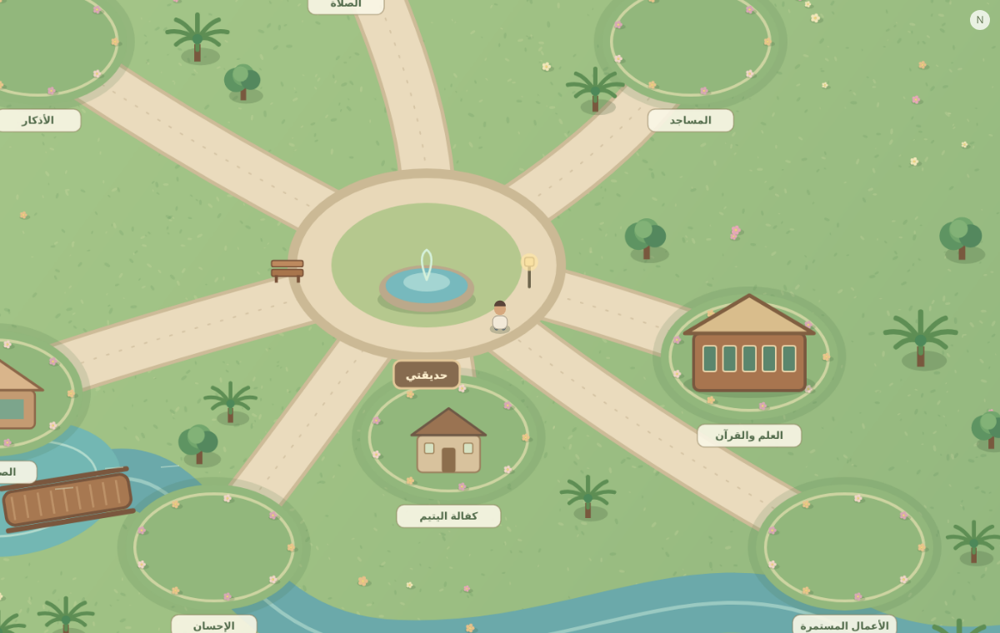

# حديقتي



شعار التطبيق: [فتح ملف SVG](assets/logo.svg) · أيقونات PWA ضمن مجلد `assets/`.

تطبيق ويب عربي تفاعلي (PWA) لحديقة ثنائية الأبعاد يمكن التجول فيها، واستكشاف مناطقها، وتسجيل المهام الشخصية، وقراءة مراجع دينية مع روابط مصادرها، وبناء الحديقة بعناصر تحفظ محلياً.

## تشغيل محلي سريع

لا يحتاج المشروع إلى Node أو عملية بناء. شغّل خادماً محلياً من جذر المجلد:

```bash
python -m http.server 8000
```

ثم افتح `http://localhost:8000` في المتصفح. لا تفتح `index.html` بالنقر المزدوج؛ وحدات JavaScript وميزة Service Worker تحتاجان إلى HTTP أو HTTPS.

## النشر على GitHub Pages

1. أنشئ مستودع GitHub جديداً باسم تختاره.
2. ارفع **كل محتويات هذا المجلد** إلى جذر المستودع، وليس المجلد الأب نفسه.
3. افتح `Settings → Pages`.
4. في `Build and deployment` اختر `Deploy from a branch`.
5. اختر الفرع `main` والمجلد `/ (root)` ثم احفظ.
6. انتظر انتهاء نشر GitHub Pages وافتح الرابط الذي يعرضه GitHub.

المشروع يستخدم مسارات نسبية (`./`) حتى يعمل أيضاً عند النشر داخل مستودع Project Pages.

## التحكم

- الكمبيوتر: الأسهم أو `W A S D` للحركة، و`E` للتفاعل مع أقرب مرفق.
- الهاتف: عصا التحكم أسفل يسار الشاشة، وزر «تفاعل» لفتح المكان القريب.
- لمس أرضية الخريطة يوجّه الشخصية إلى الموقع الذي لمسته.
- من «المخزون» اختر «وضع»، ثم اضغط مساحة خضراء مناسبة. يمكن نقل العناصر أو إعادتها للمخزون.

## الحفظ والنسخ الاحتياطي

- تحفظ بيانات الملف والمهام والجلسات والعناصر والحديقة في IndexedDB على الجهاز.
- الحفظ تلقائي بعد تغييرات البيانات المهمة، كما يحفظ موضع الشخصية بعد توقفها أو انتقال الصفحة للخلفية.
- استخدم «النسخ الاحتياطي والاستعادة» لتنزيل ملف JSON أو استعادة نسخة سابقة.
- حذف بيانات الموقع من المتصفح قد يحذف نسخة الضيف. النسخ الاحتياطي ضروري قبل تغيير الجهاز.

## المزامنة السحابية الاختيارية

GitHub Pages خدمة استضافة ملفات ثابتة وليست قاعدة بيانات خاصة للمستخدمين. أرفقنا تكاملاً اختيارياً مع Supabase، لكن لا يمكن تفعيله قبل أن تنشئ مشروع Supabase خاصاً بك:

1. أنشئ مشروعاً في Supabase.
2. افتح `SQL Editor` وشغّل `supabase/schema.sql`.
3. من إعدادات API انسخ Project URL ومفتاح `anon` أو `publishable` العام فقط.
4. في التطبيق افتح `الإعدادات → إعداد المزامنة السحابية` والصق الرابط والمفتاح.
5. أدخل بريدك الإلكتروني واطلب رابط الدخول. اضبط عنوان إعادة التوجيه في Supabase ليشمل رابط GitHub Pages الخاص بك.
6. بعد تسجيل الدخول استخدم «مزامنة الآن». إذا وُجدت نسخة أحدث، سيعرض التطبيق خيار التحميل أو الاحتفاظ بالنسخة المحلية ورفعها.

**مهم:** لا تستخدم مطلقاً `service_role` أو كلمة مرور قاعدة البيانات في JavaScript أو GitHub. المفتاح العام وحده ليس بديلاً عن سياسات RLS؛ ملف SQL يفعّل سياسات تمنع المستخدم من قراءة نسخة حساب آخر أو تعديلها.

## البنية

```text
hadiqati/
├── index.html
├── styles.css
├── manifest.webmanifest
├── service-worker.js
├── assets/
│   ├── logo.svg
│   └── favicon.svg
├── js/
│   ├── app.js       # الواجهة وتنسيق تدفق الاستخدام
│   ├── db.js        # IndexedDB والنسخ الاحتياطي والتحقق
│   ├── content.js   # المناطق والعناصر وسجلات المراجع الأولية
│   ├── world.js     # رسم العالم والحركة والتصادم والكاميرا
│   └── sync.js      # تكامل Supabase الاختياري
├── supabase/
│   └── schema.sql
├── docs/
└── tests/
```

## المحتوى الديني: حدود مهمة

تحتوي المكتبة على أربعة سجلات أولية مع رابط إلى صفحة المصدر ودرجة الحديث كما تظهر في المرجع الإلكتروني. هذه السجلات موسومة في الواجهة بأنها **مراجعة مصدر أولية** وتحتاج اعتماداً بشرياً متخصصاً قبل استخدامها كمحتوى رسمي أو ربطها بإنجازات. لا تتضمن النسخة مكافآت شرعية، ولا تحسب الحسنات، ولا تدعي معرفة النية أو القبول. العداد يسجل ضغطات المستخدم فقط، ولا يثبت أداء الذكر.

المراجع المصدرية الأولية:

- مشكاة المصابيح 2304: https://sunnah.com/mishkat:2304
- سنن النسائي 1797: https://sunnah.com/nasai:1797
- صحيح مسلم 533a: https://sunnah.com/muslim:533a
- صحيح البخاري 6005: https://sunnah.com/bukhari:6005

راجع `docs/CONTENT_REVIEW.md` قبل إضافة أو نشر أي نص ديني جديد.

## ما هو منفذ حالياً وما يحتاج إعداداً أو تطويراً

**منفذ في هذه النسخة:** العالم ثنائي الأبعاد، مناطق متصلة بالممرات، تحريك بلوحة المفاتيح واللمس، تفاعل مع المناطق، عناصر قابلة للزراعة والنقل والإعادة للمخزون، مهام شخصية قابلة للإضافة والتكرار، عدادات شخصية قابلة للاستكمال، المكتبة والبحث والمفضلة، سجل الرحلة، إعدادات، IndexedDB، تصدير/استيراد نسخة احتياطية، PWA وملف Service Worker، تكامل Supabase اختياري وSQL مع RLS.

**يتطلب إعداداً خارج ملفات المشروع:** المزامنة السحابية لا تعمل قبل إنشاء مشروع Supabase وإدخال URL ومفتاح anon العام وتشغيل SQL وضبط إعادة توجيه البريد الإلكتروني.

**ليس ضمن النسخة الحالية:** لوحة إدارة محتوى حقيقية بصلاحيات بشرية، مراجعة شرعية بشرية، إشعارات خلفية مضمونة عبر كل المتصفحات، حسابات مستخدمين داخل التطبيق دون مزود خارجي، محرك خرائط قابل للتحرير من واجهة إدارية، مزامنة تعاونية لحظية بين جهازين، ودعم لغات متعددة.

## الاختبار

راجع `tests/manual-checklist.md` لاختبار الحركة والبناء والحفظ والاستعادة والشاشات. لا تعتبر النسخة معتمدة للإطلاق العام قبل اختبارها على أجهزة ومتصفحات فعلية، وضبط خدمة المزامنة إذا كانت مطلوبة، ومراجعة المحتوى الديني بشرياً.
